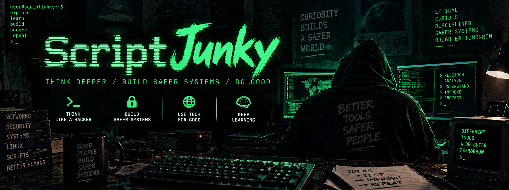

# Script Junky

A local field school for terminal fluency, shell scripting, ethical security work, and evidence-based investigation. It pairs a native terminal workflow with a responsive learning dashboard. Python 3.11+ is the only application dependency.

The dashboard uses a retro workstation theme inspired by phosphor terminals, BBS menus, WarGames, and the 1990s hacker aesthetic: black and green surfaces, monospace type, amber controls, cyan/magenta accents, and subtle static scanlines. The theme covers lessons, the coach, practice, the journal, the toolbox, and editors. System reduced-motion preferences remove the scanline texture; no flicker or animated overlay is used. Fonts and visual assets are local, so the theme needs no external downloads.

## Start

From the project directory on macOS or Linux:

```sh
python3 --version
python3 scriptjunky.py doctor
python3 scriptjunky.py serve
```

Open the loopback URL printed by the server, normally `http://127.0.0.1:8765`. Keep that terminal running. On startup, the dashboard prepares every lesson folder automatically, including evidence and blank result files. With the default checkout workflow, these are visible under `labs/` in the project. If the port is occupied, use `serve --port 0` to choose an available port, or `serve --port 8877` to choose one yourself. The HTTP lesson in the dashboard uses your actual port.

No pip install, account, cloud service, API key, or network download is needed for the app. Python must already be installed. Optional tools such as wget, jq, and ShellCheck are covered by platform-specific reference cards; the app never installs them automatically.

## What the learner gets

- **17 guided lessons:** scope, navigation, quoting, pipelines, text processing, permissions, package managers, curl/wget, reusable shell scripts, processes, SHA-256, timelines, threat modeling, a capstone investigation, attack paths, startup-job hunts, and threat evaluation. Approximately seven hours of worked exercises, plus independent practice and reflection.
- **References for every learning objective:** clickable reading links in the learning path, beside the objective, and beside its field application. Each lesson explains its discipline, the specific source sections, what those sections support, and which exercise details are original course design. The terminal lesson view prints the same provenance and URLs.
- **Supplied practice files:** the project includes real files under `training/evidence/` and blank output templates under `training/starters/`. The dashboard automatically prepares a private working copy for each of the 17 lessons. Every lesson shows its actual directory and lets you preview its evidence and result files. Use your terminal or editor to complete the provided outputs; no manual folder or sample-file creation is needed. Worked recipes are hidden behind a disclosure in the dashboard.
- **26 command-family reference cards:** common tools, intended use, example syntax, side effects, macOS/Linux differences, and links to primary tool documentation. Package references cover Homebrew, APT, DNF, pacman, and apk. Check each manual's implementation against your local man page.
- **32 recall cards:** shuffled choices, explanations, and a persistent review schedule. Correct answers return after 1, 2, 4, 8, 16, then 30 days; incorrect answers return after 10 minutes. Recall complements terminal practice and adversarial reasoning.
- **Investigation coach:** select an industry, evidence context, and observed changes to build an investigation plan. Nine guides cover account abuse, startup persistence, web shells, suspicious use of trusted tools, account/key changes, writable configuration, data movement, ransomware indicators, and dependency trust. Each gives observation prompts, corroboration, ordinary explanations, platform notes, defensive controls, and a next test.
- **Adversarial thinking and threat worksheet:** connect assets, attacker goals, starting access, entry points, and trust boundaries. Rate impact, likelihood, and evidence confidence separately, explain each, and save the assessment to your journal. Unknown likelihood is an explicit valid judgment.
- **Source-linked case studies:** Volt Typhoon, Ivanti gateway exploitation, LockBit, and the xz backdoor illustrate investigation habits, with report dates and limits. They are historical teaching cases, not current exposure findings or a threat feed.
- **Field journal:** record scope, commands, observations, hypotheses, confidence, limitations, and next steps. The first successful check of each lesson adds a timestamped artifact-check record automatically. Notes can be edited, searched, and deleted.
- **Script toolbox:** save, edit, search, tag, copy, and download snippets. Tags group scripts around tasks such as `logs`, `inventory`, `triage`, and `forensics`. Three starter snippets demonstrate common patterns.
- **Portable work:** export a readable Markdown notebook or a JSON record containing journal entries, snippets, verified lessons, attempts, and reviews. Individual scripts export as `.sh` files.

## A terminal-only session

The CLI and dashboard share the same SQLite database:

```sh
python3 scriptjunky.py learn
python3 scriptjunky.py lesson pipelines
python3 scriptjunky.py lab start pipelines
```

Reading a lesson prepares its files and prints an accurately quoted `cd` command. Enter that directory before using any `evidence/` or `output/` path. The evidence files already exist, and result files are supplied as blank templates. Fill them in with your findings, or use commands that write to those files. The lab-start output also prints an absolute command that checks the artifacts from any directory. To prepare all folders without the dashboard, run `python3 scriptjunky.py lab prepare`.

From the project directory, the equivalent check is:

```sh
python3 scriptjunky.py lab check pipelines
python3 scriptjunky.py practice
python3 scriptjunky.py commands curl
python3 scriptjunky.py investigate method
python3 scriptjunky.py investigate plan --industry finance --platform macos --signal login-spike --signal account-change
python3 scriptjunky.py investigate show persistence
python3 scriptjunky.py investigate cases
```

Checks return status 0 when all required artifacts pass, 1 when a lab needs work, and 2 for an operational or input error.

Save a work note or script from an existing UTF-8 file:

```sh
python3 scriptjunky.py journal add --title 'Authentication triage' --lesson pipelines --file my-notes.txt
python3 scriptjunky.py journal list --search authentication
python3 scriptjunky.py snippet add --title 'My log counter' --tags logs,triage --description 'Input: the lab SSH log format' --file my-counter.sh
python3 scriptjunky.py snippet list --search triage
python3 scriptjunky.py snippet export 1 --output saved-counter.sh
python3 scriptjunky.py export --format markdown --output field-notebook.md
python3 scriptjunky.py export --format json --output learning-record.json
```

Exports refuse to overwrite an existing file. Use a fresh filename. Both collections support `show ID`, `edit ID` with the same fields as add, and `delete ID`. Run a command with `--help` for full syntax. No saved snippet is executed by the app.

## Your data

By default, data lives at `$XDG_DATA_HOME/scriptjunky`, or `~/.local/share/scriptjunky` when that environment variable is unset:

```text
Your data directory/
  learning.sqlite3        journal, snippets, progress, attempts, review schedule

Project directory/
  training/
    evidence/             supplied original fictional evidence
    starters/             blank result templates, grouped by lesson
  labs/
    scope/
      evidence/           supplied working copy of evidence
      output/scope.json   provided blank scope document
    pipelines/
      evidence/           supplied working copy of evidence
      output/failures.txt provided result file for your command output
```

Override the location with a global `--home` option or `SCRIPTJUNKY_HOME`:

```sh
python3 scriptjunky.py --home .scriptjunky serve --port 0
python3 scriptjunky.py --home .scriptjunky learn
```

Use the same data and practice locations for CLI and dashboard sessions. An explicit `--home` keeps practice folders under that data directory. Use `--labs-dir labs` to keep practice files visible in the project while storing notes elsewhere; the dashboard’s check commands include both locations. Existing default data-home labs keep their earlier location. The directory is initially private (mode 700) and the database is mode 600. The intentionally world-writable configuration fixture lives inside a private lab directory.

For a complete recoverable backup, stop the server and CLI operations, then copy both the data directory and the active practice directory shown by the app. By default the latter is the project’s `labs/`; with an explicit `--home`, it is that directory’s `labs/` unless `--labs-dir` chooses another location. Restore the data with `--home` and select the restored practice directory with `--labs-dir`. JSON and Markdown exports are useful portable records; version 0.2 does not include a JSON importer or automatic device sync. Uninstalling the source code does not remove your saved data.

Lab preparation is idempotent: it resumes an existing marked lab, adds any missing starter outputs, and preserves existing work and evidence. If you alter evidence, preserve your output, then select a fresh `--home` or a fresh `--labs-dir`. There is deliberately no destructive reset command. Blank templates do not count as completed exercises. Source-control checkouts normalize permission bits; the app sets the intended permissions on working copies, including the permissions exercise’s writable configuration.

## Connection to real security work

The learning loop is **question → command → evidence → hypothesis → verification → report**. Learners practice the mechanics of:

| Exercise | Professional application | Judgment to develop |
| --- | --- | --- |
| Scope and inventory | Define a bounded engagement and discover useful artifacts | Understand authorization, side effects, and collection limits |
| Authentication pipelines | Summarize logs into investigation leads | Failed logins alone do not prove compromise |
| Config permissions and listener snapshots | Review a host's attack surface | Distinguish a trust-boundary risk from a verified exploit or reachable service |
| Package and process baselines | Identify unfamiliar software and execution paths | An unexpected item needs corroboration |
| Bounded HTTP retrieval | Collect an authorized resource reproducibly | Understand transport errors, redirects, credentials, and TLS |
| Parameterized scripts | Turn a repeatable analysis into a tool | Validate input, quote paths, preserve diagnostics, test edge cases |
| Hashes and timelines | Document evidence integrity and sequence | Integrity is distinct from provenance; sequence is distinct from causation |
| Threat model and capstone report | Explain possible abuse and propose verifiable controls | Separate observed facts, assumptions, confidence, and next steps |
| Attack-path and startup-job hunts | Identify plausible routes across trust boundaries and persistent execution leads | Verify preconditions; a captured definition does not prove execution |
| Threat evaluation worksheet | Prioritize an investigation and hand it to another analyst | Keep impact, likelihood, confidence, alternatives, and next tests distinct |

The forensic emphasis is informed by [NIST SP 800-86](https://csrc.nist.gov/pubs/sp/800/86/final). The coach links possible behaviors to [MITRE ATT&CK](https://attack.mitre.org/), risk questions to [NIST SP 800-30 Rev. 1](https://csrc.nist.gov/pubs/sp/800/30/r1/final), response habits to [NIST SP 800-61 Rev. 3](https://csrc.nist.gov/pubs/sp/800/61/r3/final), business assets to [NIST CSF 2.0](https://www.nist.gov/cyberframework), and defenses to [CIS Controls v8.1](https://www.cisecurity.org/controls/cis-controls-list). Threat-modeling prompts use [Microsoft's STRIDE categories](https://learn.microsoft.com/en-us/azure/security/develop/threat-modeling-tool-threats). These are curated teaching mappings, not a formal compliance crosswalk or certification. The app also links official shell, HTTP, and package-manager references.

Industry contexts cover a general host, healthcare, financial services, SaaS, and critical infrastructure. They emphasize different business assets and questions; they do not assert attack prevalence or calculate risk. Plans first order guides by overlap with selected observations, then by illustrative asset priorities. The coach never scans the host. Linux/macOS contexts describe potential evidence sources; executable examples use captured synthetic lab files only.

The startup lab contains inert captured cron text and a LaunchAgent plist, not registered jobs or executable payloads. Existing v0.1 labs keep their original fixture set when upgrading. New reasoning labs add their own observation and startup captures. Worksheet drafts and investigation-plan selections remain in browser memory until the page reloads; save a worksheet to the journal for persistence.

The tool teaches collection and reasoning on generated evidence. It does not provide automated exploitation, stealth, credential attacks, or privileged collection. Your manually operated terminal is **real and is not sandboxed** by the app. Artifact checks confirm expected results, evidence contents, and fixture mode bits; they cannot prove that a learner used a particular command, that a script handles every input, or that a written conclusion is well supported. Formal forensic acquisition and chain-of-custody procedures require additional tooling and organizational process.

Learning objectives and field applications use original Script Junky wording. Every lesson's **Where this objective comes from** panel separates its discipline, primary reading, and course adaptation. For example, establishing investigation scope and preserving decisions combines [NIST SP 800-115 §6.5](https://nvlpubs.nist.gov/nistpubs/Legacy/SP/nistspecialpublication800-115.pdf#page=51) on assessment planning with [NIST SP 800-61 Rev. 3, RS.AN-06/07](https://nvlpubs.nist.gov/nistpubs/SpecialPublications/NIST.SP.800-61r3.pdf#page=37) on investigation records and collected data. This applies to assessment and incident-response work; it is broader than threat analysis alone. The sentence, lab boundary, JSON schemas, grading rules, and threat worksheet's rating labels are teaching design, not direct quotations or universal requirements. References were reviewed on October 9, 2026; source editions and section names are visible in the app. The complete mapping lives in `junky/references.py`.

## macOS, Linux, other Unix, and iPad

macOS and Linux are the initial targets. Recipes favor POSIX `sh` and common tools, with explicit differences for BSD/GNU utilities and optional Linux tools. The macOS-provided Bash can be older than modern GNU Bash, so the core exercises avoid modern Bash-only features.

Other Unix environments need Python 3.11+ and the tools used by a lesson; check `doctor` and local man pages. BusyBox variants, ACL behavior, package managers, and utility flags can differ. No claim of testing every Unix is made.

The responsive dashboard is ready for a tablet-sized browser. For iPad use, run the app on a Mac/Linux host with an existing authorized SSH connection. Configure a client that supports local port forwarding to map the iPad's localhost port to the host's loopback server, then open the forwarded localhost URL in Safari. Keep the tunnel active while using Safari. Choose the same local and remote port so Host/Origin protections still match. Terminal exercises execute on the host over SSH. There is no LAN bind mode.

From a Unix SSH client, the equivalent forwarding pattern is:

```sh
# On the host:
python3 scriptjunky.py serve --port 8765

# On the client; replace user@training-host with your authorized host:
ssh -N -L 127.0.0.1:8765:127.0.0.1:8765 user@training-host
```

A native iPad shell, offline tablet package, and device synchronization are future work. A browser on its own cannot execute commands against the iPad filesystem.

## Development and validation

```sh
python3 -m unittest discover -s tests -v
node --check junky/static/app.js  # optional developer check; Node is not a runtime dependency
```

Tests execute worked recipes against disposable fixtures, verify the HTTP exercise with a loopback server, check script edge cases, persist/reload data, validate capstone facts, reject malformed artifacts, enforce same-origin/token checks, and exercise the CLI. Coach checks cover plan ordering, input validation, valid learning links, inert startup evidence, separate judgments, and traceable observation references. Version 0.2 passes 34 tests on macOS with Python 3.14, including complete objective/reference coverage, source metadata delivery through the API, CLI provenance output, bundled files, blank starters, preservation of existing work, custom practice locations, and bounded file previews. Browser verification covered all 17 lesson source panels and all 26 command cards, with a tablet layout check. Linux and Python 3.11/3.14 are covered by a supplied CI matrix once this project is hosted on GitHub; those remote jobs have not been run here.

See [the execution plan](docs/EXECUTION_PLAN.md) for delivered scope and the next stages.
